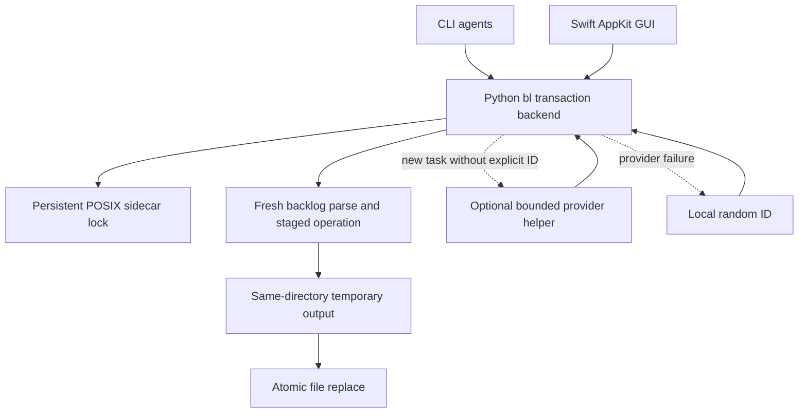

# fix: Make backlog operations safe under concurrency

## Overview

Keep `backlog.md` as the human-readable source of truth while serializing every cooperating CLI and macOS GUI transaction through one standard-library Python implementation. Add persistent task IDs, safe ID-based claims, local legacy migration, atomic replacement, and optional semantic IDs with a non-blocking local fallback. Retain existing numeric CLI syntax with an explicit staleness warning. This plan works from the requirements and acceptance decisions in [the origin document](../brainstorms/2026-09-30-concurrent-backlog-requirements.md); the user selected macOS/Linux support for the first version.

---

## Problem Frame

`bl` is distributed as one dependency-free Python script containing both the CLI and embedded Swift/AppKit GUI. Both currently perform unlocked read–modify–write operations; Python truncates the file during writes, and GUI actions rely on mutable line numbers. Atomic saving in Swift does not serialize the earlier read and change. Two agents can overwrite each other, and `take` does not verify that a task is still free. The GUI also duplicates persistence and can apply stale status/edit intentions to a different current state.

The solution must protect the shared single local file for cooperating up-to-date `bl` processes, not promise coordination with direct editors, old clients, distinct clones/worktrees, network filesystems, or power-loss durability.

---

## Requirements Trace

- R1–R3. One bounded sidecar lock serializes read/validate/mutate/publish; unreadable files fail closed; replacement is atomic.
- R4–R8. Stable visible IDs, uniqueness across both sections, dependency-free local generation and first-access migration, optional API suggestion outside the lock, safe random fallback.
- R9–R11. ID and legacy numeric command addressing; conditional free-task take; clear errors for invalid targets.
- R12. GUI uses the shared transaction backend, stable selection, intention-based status actions, and conflict-safe text editing.
- R13. Setup/run guidance directs agents to ID-based take and requires a successful claim before work.
- Success criteria: no lost cooperating writes; no double successful claim; readable Markdown; provider-independent operation; parallel regression tests.

**Origin actors:** A1 (agent), A2 (person using CLI/GUI), A3 (optional ID provider).

**Origin flows:** F1 (automatic first-access migration), F2 (add with stable ID), F3 (competing claim).

**Origin acceptance examples:** AE1 (parallel adds), AE2 (one successful claim), AE3 (reorder/archive targeting), AE4 (provider collision/failure), AE5 (parallel migration), AE6 (process termination during transaction), AE7 (provider call outside lock), AE8 (stale GUI edit).

---

## Scope Boundaries

- First version supports local macOS/Linux/POSIX locking. Windows CLI locking parity is not included; unsupported locking must fail clearly rather than silently run unlocked.
- No protection against direct file edits, stale/old `bl` versions, independent worktrees/clones, network filesystems, or hard-linked backlog aliases.
- No database, daemon, third-party runtime dependency, lock ownership/lease, automatic stale-task release, work deduplication after a lost acknowledgment, or power-loss durability guarantee.
- Existing numeric command syntax remains and is explicitly best-effort if the line changed since it was displayed; do not add revision-token syntax.
- No automatic ID conflict repair command; report duplicate existing IDs with locations and document safe manual recovery.
- No automatic “take next” operation; agents select a task and atomically claim it by ID.

---

## Context & Research

### Relevant Code and Patterns

- `bl`: one-file Python CLI, embedded `BL_GUI_SOURCE`, command dispatch in `main()`, and standalone Swift-side `commandAction(for:)` for `bl gui ...` subcommands.
- `bl`: Python persistence `read_backlog()` / `write_backlog()`, mutations `add()`, `set_status()`, `purge()`, plus `run_gui()` which currently materializes Swift source at one fixed temporary path.
- `bl`: Swift `BacklogStore` duplicates parsing and all mutations; `BacklogTask` identifies rows by line number; the modal edit closes before save; GUI status hotkey currently behaves as a toggle.
- `README.md`, `CLAUDE.md`, and `AGENTS.md`: public docs and agent guidance. Repository research confirmed `AGENTS.md` is a symlink to `CLAUDE.md`; update the underlying instructions once, not twice.
- No test suite, test runner configuration, CI, or `docs/solutions/` learnings exist. Use Python standard-library `unittest` with subprocess integration and temporary directories.

### Institutional Learnings

No `docs/solutions/` directory or matching historical learnings were found. Preserve the single-file, zero-dependency distribution model and use the requirements document as the product source of truth.

### External References

- Python `fcntl.flock`: https://docs.python.org/3.11/library/fcntl.html
- Python `os.replace`: https://docs.python.org/3.11/library/os.html#os.replace
- Python `tempfile.mkstemp`: https://docs.python.org/3.11/library/tempfile.html#tempfile.mkstemp
- Python `urllib.request.urlopen`: https://docs.python.org/3.11/library/urllib.request.html#urllib.request.urlopen
- OpenAI Responses model: https://developers.openai.com/api/docs/models/gpt-6-luna
- OpenAI text response parsing: https://developers.openai.com/api/docs/guides/text
- Anthropic Haiku model: https://platform.claude.com/docs/en/models/haiku-4-5/overview
- Anthropic Messages API: https://platform.claude.com/docs/en/api/messages/create.md

External guidance supports persistent advisory sidecar locks plus same-directory replacement, strict validation of raw HTTP responses, and avoiding live API dependencies in tests. Current model candidates are `gpt-6-luna` (OpenAI, low published price) and `claude-haiku-4-5-20251001` (Anthropic, positioned for low latency); model identifiers are centralized configuration choices, not permanent guarantees or measured latency comparisons. Prefer OpenAI when both nonempty keys exist; if the selected provider fails, use local randomness rather than attempting a second network provider.

---

## Key Technical Decisions

- **One Python transaction/backend implementation for every writer.** Route Swift window operations and `bl gui` subcommands through the existing Python process/script entry point instead of maintaining two file stores. This is the only way one lock and one set of validation rules protect both interfaces. Keep the embedded single-file distribution; use structured subprocess arguments/input/output rather than shell interpolation.
- **POSIX advisory sidecar lock + same-directory temporary file + `os.replace`.** Resolve the backlog path canonically so symlink aliases share the same sidecar; use a persistent `.backlog.lock` that is never unlinked. Acquire a nonblocking exclusive `flock` with a monotonic deadline (start with a 5-second user-visible bound), then fresh-read, validate, mutate and publish while holding it. Never lock the replaceable backlog inode or fall back to truncate-in-place. Reject hard-linked existing targets (`st_nlink > 1`) because path canonicalization cannot make independent hard-link names share an adjacent lock.
- **Stage first-access migration with the requested transaction.** Parse and validate all existing active/archive IDs before generating any. Stage missing IDs in memory. Combine staged migration with the requested mutation; if it is rejected, write nothing, including incidental IDs. A successful read/migration commits once under lock. An unreadable/unwritable file yields a clear error rather than ephemeral IDs or a false empty backlog.
- **ID grammar and precedence.** Only a valid final whitespace-delimited `#ID` token is metadata; match `[A-Za-z][A-Za-z0-9_-]{4,5}` for generated IDs, preserve case, and compare IDs case-sensitively. Explicit final IDs may be longer but use the same character grammar and cannot be all numeric; only an explicit duplicate rejects. Other or malformed hashtags remain description text. For `add`, reserve an explicit incoming ID before migrating old entries. A generated collision gets a fresh random ID locally, not another API call. Exclude the metadata token from `ASAP`/`FIX` priority checks. Reject CR/LF in CLI additions; normalize multiline GUI input to a single line.
- **Optional semantic ID request outside the lock.** If no explicit final ID exists, select one provider deterministically (nonempty OpenAI key first, otherwise Anthropic); no key means local random ID. Limit description size, send only the new task text to the official fixed HTTPS endpoint, set strict response caps, and validate a single exact ID candidate. Use standard-library HTTP only. To bound a stalled provider without holding the lock, isolate candidate generation in a short-lived helper subprocess with a parent deadline; if it fails/times out, proceed with local randomness. No retry and no fallback to the other provider. Secrets, raw response bodies, and provider exception details never appear in logs or backlog. The GUI must not block its AppKit main thread for provider work.
- **Intention-based status/edit operations.** GUI passes “take” or “untake” based on what it displayed, not an unconditional toggle. Check expected displayed status to prevent a stale GUI release/reopen. For text edits, capture ID and original description; on save resolve ID in the fresh active section, compare description, retain any concurrently changed status, and save only if text is unchanged. On archived/missing/conflicting target, report the outcome while keeping the user's draft available.
- **Preserve existing compatibility deliberately.** Numeric arguments continue to mean physical active-section line numbers, including non-task/blank lines; they are not stable references. `take` succeeds only for `[ ]`; reject invalid/non-task lines. Keep current CLI `done`/`untake` active-task status behavior and priority ordering unless tests reveal unavoidable change. Preserve existing uppercase `[X]` display semantics and lowercase-only purge behavior to avoid unrelated format expansion.
- **No power-loss promise.** Flush/close the temporary file and replace atomically. Skip platform-specific directory durability work for now; process termination must leave a whole old or new document, but sudden power loss may lose the latest acknowledged write.

---

## Open Questions

### Resolved During Planning

- **Locking platforms?** macOS and Linux in v1; selected by user. Windows must fail clearly, not use unlocked writes.
- **If both provider keys are present?** Prefer OpenAI (`gpt-6-luna`) based on currently published lower price; failure falls back to randomness, not Anthropic.
- **What happens when migration coincides with a rejected mutation?** Neither migration nor mutation persists. This preserves the no-write-on-rejection guarantee.
- **What does a stale GUI status hotkey do?** Reject if the displayed expected status no longer matches; never toggle a freshly read status blindly.
- **What does terminal `#` text mean?** Only final syntactically valid token is ID; other hashtags remain description. Preserve ID case. Description-only priority evaluation prevents IDs like `#FIXab` from making tasks priority.
- **What if purge archives the GUI edit target?** Saving fails visibly and preserves the draft; do not resurrect the task. Status-only concurrent changes do not conflict with text editing.
- **What about non-task/blank numeric lines and other status transitions?** Preserve physical line numbering, but reject a non-task target. Retain current `done`/`untake` transitions and uppercase `[X]` purge behavior.

### Deferred to Implementation

- Exact private backend command names, JSON envelope fields, and process lifecycle/error presentation; settle while implementing the Swift bridge, maintaining a stable one-file install.
- The helper-process wall-clock cutoff must be validated against actual provider behavior; isolate candidate generation only and never automatically retry a possibly committed backlog mutation. Process creation itself may not be fully interruptible by the OS.
- Native GUI interaction verification requires macOS/AppKit. Python-side transaction and bridge behavior can be automated on POSIX CI or local machines; add a focused manual macOS verification checklist.
- POSIX ACLs, ownership, and extended attributes are not guaranteed to survive replacement; preserve permission mode bits. Hard-linked target files fail closed. If either constraint is unacceptable, revisit before implementing.
- Model availability/pricing can change; keep model IDs centralized and refresh official documentation when implementing. API-dependent tests use mocked HTTP responses only, with no credentials or paid calls.

---

## High-Level Technical Design

> *This diagram illustrates the intended interaction and is directional guidance for review, not an implementation specification. The implementing agent should treat it as context, not code to reproduce.*

```mermaid
sequenceDiagram
    participant C as CLI agent
    participant G as Swift GUI
    participant P as Python bl backend
    participant M as Optional model API
    participant L as Local ID generator
    participant F as backlog.md + sidecar lock
    C->>P: request add / take / show
    G->>P: request GUI action by task ID
    opt New task without explicit ID
        P->>M: bounded description (outside lock)
        alt Valid candidate
            M-->>P: candidate ID
        else Missing key / failure / timeout
            P->>L: generate candidate
        end
    end
    P->>F: acquire lock; fresh read + validate
    P->>P: stage migration + requested operation
    alt Rejected / stale / invalid
        P-->>C: error; no write
        P-->>G: error; preserve draft/state
    else Accepted
        P->>F: write same-directory temp; atomic replace
        P-->>C: result
        P-->>G: result by stable ID
    end
```

---

## Implementation Units

- [x] U1. **Add stable-ID parsing and staged migration**

**Goal:** Define one canonical interpretation of task IDs and plan in-memory migration for old active/archive entries without altering other Markdown.

**Requirements:** R4, R5, R8; F1; AE3, AE4, AE5.

**Dependencies:** None.

**Files:**
- Modify: `bl`
- Create: `tests/test_backlog.py`

**Approach:** Add pure parsing/indexing/generation helpers in the Python portion of `bl`; keep line text stable except for ID insertion. Detect duplicate existing IDs across both sections before generating anything; report conflicting locations without silent repair. Extract only a syntactically valid final ID token; preserve other hashtags. Stage missing IDs locally and reserve incoming explicit IDs before generating during add. IDs remain attached while status/description changes and during archival.

**Execution note:** Add characterization tests for current Markdown splitting, priority ordering, numeric physical-line semantics, and archive handling before centralizing task parsing.

**Patterns to follow:** Existing single-script standard-library Python, `read_backlog()` section model, current `---` archive separator and `- [status] description` rows.

**Test scenarios:**
- Happy path: parse final `#refreshDesign`, preserve an earlier hashtag in title, maintain case-sensitive IDs, and retain IDs through status/description/purge transformations.
- Edge case: generated IDs are 5–6 characters, start with a letter, and avoid every active/archive ID plus an explicit add-ID reserved for the same transaction.
- Error path: duplicate legacy IDs report both physical locations; malformed hashtags and pure-numeric terminal tokens remain description and receive a generated ID.
- Error path: CLI descriptions containing CR/LF are rejected before creating multiple task rows; GUI normalization is specified for bridge integration.
- Covers AE3: line text remains ID-addressable after unrelated active tasks are reordered or archived.

**Verification:** Pure tests prove stable parse/format round-trips, deterministic duplicate detection, and migration leaves non-task Markdown lines, separators, status, and order unchanged.

---

- [x] U2. **Serialize and atomically commit backlog transactions**

**Goal:** Establish the single POSIX transaction boundary used by every reader that performs migration and every mutating backend operation.

**Requirements:** R1–R3, R8; F1; AE1, AE5, AE6, AE7.

**Dependencies:** U1.

**Files:**
- Modify: `bl`
- Test: `tests/test_backlog.py`

**Approach:** Introduce a persistent canonical-path sidecar lock with bounded nonblocking `flock` acquisition and a monotonic timeout. Use a transaction that reads the latest file, validates/migrates in memory, invokes one domain operation, and publishes only when accepted/changed. Save through a unique same-directory temporary file and `os.replace`; preserve POSIX permission mode bits. Clean up only the current temp file; never unlink the lock. Fail clearly on unsupported platform, hard-linked target, permission/read/decode errors, and lock timeout. Keep migration on first access, but combine it with the requested write so a rejected operation persists nothing.

**Patterns to follow:** Existing `BACKLOG` current-directory semantics and stdlib-only distribution; research-grounded `flock`, `mkstemp`, and `os.replace` behavior.

**Test scenarios:**
- Happy path: two processes add unique tasks behind a barrier; every accepted row and ID occurs exactly once, mode bits remain, lock file remains present.
- Edge case: two simultaneous first-access operations migrate the same old active/archive file to unique IDs once; subsequent read leaves file bytes unchanged.
- Error path: lock holder blocks a second transaction until the bounded deadline; second exits nonzero, writes nothing, and reports contention.
- Error path: missing file on display does not create one; unreadable/invalid UTF-8 existing file, temp-write error, and `st_nlink > 1` fail closed rather than appearing empty or being truncated.
- Covers AE6: terminate a writer immediately before/after publication; backlog is always complete old or complete new content, and a later process can acquire the persistent lock.
- Edge case: aliases through symlinked paths resolve to a single transaction lock; unsupported Windows invocation reports unsupported locking without writing.

**Verification:** Multi-process tests reliably reproduce concurrent add/claim/migration attempts; failures preserve bytes and the target remains parseable.

---

- [x] U3. **Make CLI operations ID-aware and conditional**

**Goal:** Extend CLI operations without breaking numeric syntax, and make `take` an exclusive state transition.

**Requirements:** R5, R8–R11, R13; F2–F3; AE2–AE5.

**Dependencies:** U1, U2.

**Files:**
- Modify: `bl`
- Test: `tests/test_backlog.py`

**Approach:** Route CLI add/status/purge through the transaction backend. Accept ID or numeric target for `take`, `done`, and `untake`; IDs identify active tasks, numeric operands retain current physical active-line meaning. `take` requires exactly `[ ]` and changes it to `[>]`; reject busy/done/missing/non-task rows with nonzero exit. Keep `done`/`untake` behavior for active task rows. Run priority policy and duplicate check inside the fresh transaction. Ensure rejected add/take/status does not commit staged migration. Keep view/read migration consistent and avoid saving when no migration is needed. Explicitly document stale-number semantics.

**Patterns to follow:** Current aliases, line-number messages, return codes and plain-text output in `main()`, `set_status()`, `show_available()`, `purge()`.

**Test scenarios:**
- Happy path: `bl take refreshDesign`, `bl done refreshDesign`, and `bl untake refreshDesign` modify the intended active task; legacy `bl take 3` continues to refer to the current third physical line.
- Edge case: two processes concurrently take one free ID; exactly one returns success. A second take of `[>]` or `[x]` fails without changing content.
- Error path: unknown/archived ID, out-of-range row, blank line, non-task line, explicit duplicate ID, priority rejection, and malformed command return clear nonzero results.
- Edge case: `#FIXab` metadata does not trigger priority insertion; ordinary descriptions containing ASAP/FIX retain the existing priority rule.
- Edge case: rejected operation on an un-migrated backlog leaves file byte-for-byte unchanged; accepted operation commits migration and requested change together.
- Covers AE3: reorder/purge other tasks between listing and command; ID still identifies the target while numeric syntax continues to address the current physical line.
- Covers AE4: collision of generated model/local candidate falls back to a new local random value; explicit duplicate ID fails, and task is not added.

**Verification:** CLI usage/help output communicates numeric staleness and ID syntax; each command's exit status agrees with whether its transaction committed.

---

- [x] U4. **Add bounded optional semantic-ID providers**

**Goal:** Offer a short readable ID from OpenAI or Anthropic when credentials exist, without making task entry depend on remote availability.

**Requirements:** R5–R7; F2; AE4, AE7.

**Dependencies:** U1, U2.

**Files:**
- Modify: `bl`
- Test: `tests/test_backlog.py`

**Approach:** Detect an explicit valid terminal ID before provider selection; never make a request for explicit IDs. Otherwise select OpenAI first when its key is nonempty, Anthropic second, and local generation when neither exists. Keep model IDs and endpoints centralized. Make one bounded standard-library HTTPS request using strict provider-specific response extraction and `store:false` for OpenAI; use a short-lived helper process for a parent-enforced overall deadline and pass the task text over stdin, credentials through the environment. Do not hold the backlog lock during candidate generation. Require a single full-match 5–6-character candidate; reject prose, incomplete/refused/malformed responses, overlong payloads, redirects and errors. On any provider failure/time limit/uniqueness collision generate locally, without retry or second-provider fallback. Never log secrets, raw response/error data or full provider payloads. Explain that task descriptions may be sent to the selected API. GUI invokes this path asynchronously so its main thread stays responsive.

**Patterns to follow:** Existing `urllib.request` standard-library use in `bl`; no SDK/dependency manifests. Official OpenAI Responses and Anthropic Messages request/response docs in External References.

**Test scenarios:**
- Happy path: mocked OpenAI/Anthropic valid response yields the candidate; both keys set selects OpenAI; explicit ID skips API; no keys calls local generation.
- Edge case: malformed JSON, wrong content block, non-full-match text, refused/incomplete output, too-large body, redirect, non-2xx, and provider timeout all yield local fallback and safe bounded diagnostics.
- Error path: collision with active/archive ID produces a locally unique fallback without another HTTP call; helper timeout does not hold or acquire the backlog lock.
- Security: synthetic API key and exception/body containing key material never appear in stdout, stderr, Markdown, or structured GUI error response; request includes only bounded task description, not backlog.
- Covers AE7: a deliberately slow mock provider runs while another process commits an unrelated local operation, demonstrating that provider wait does not hold the backlog lock; no real keys or paid API calls are used.
- GUI integration: provider wait is performed off the AppKit main thread and the window continues to respond.

**Verification:** Deterministic mocked HTTP/subprocess tests prove request selection, strict output validation, secret redaction and guaranteed random fallback; no external request is made in automated tests.

---

- [x] U5. **Route all GUI persistence through Python backend**

**Goal:** Make GUI selection and actions stable across concurrent CLI changes, while retaining edits and reporting stale conflicts.

**Requirements:** R1–R3, R4, R8–R12; F1–F3; AE1–AE3, AE5–AE8.

**Dependencies:** U1–U4.

**Files:**
- Modify: `bl` (embedded Swift source and `run_gui()` bridge)
- Test: `tests/test_backlog.py`

**Approach:** Replace Swift `BacklogStore` reads/writes and Swift `commandAction(for:)` mutations with calls into the same Python transaction/backend entry point. Transfer structured task data/results without shell interpolation; run every GUI add, list, take, untake, edit, move and purge through that boundary. Resolve the executable/script path explicitly for installed/self-installed `bl`, preserve cwd backlog selection, and use unique temporary materialization for embedded Swift source rather than a shared fixed `/tmp/bl-gui`. Give `BacklogTask` stable IDs and restore selection by ID. Send take/untake intent and expected displayed status, not toggle. For edit, capture ID and original description; save against fresh state only if active and unchanged, preserve concurrent status and other tasks, and keep editor draft on conflict/error. Run API-backed add asynchronously without blocking AppKit. Distinguish missing backlog from unreadable/decode failure. Do not permit a Python bridge error to fall back to Swift file writes.

**Patterns to follow:** Existing `AppController`/`BacklogStore` UI model, `BacklogError.message`, and modal editing patterns; keep the native GUI embedded in the one-file installer.

**Test scenarios:**
- Happy path: GUI bridge list/add/take/done/untake/purge/move/edit calls use Python backend and preserve active/archive sections; all `bl gui` subcommands at `commandAction(for:)` use the same transaction path.
- Edge case: GUI selects by ID, then another process inserts/reorders/archives unrelated rows; action updates the original still-active task and selection returns to its ID.
- Error path: stale displayed take/untake is rejected; a target archived or deleted during editing reports a conflict and preserves draft; concurrent description edit conflicts while status-only change is retained.
- Integration: GUI and CLI simultaneous adds and claims share one sidecar lock, with one successful claim and no lost additions.
- Error path: unreadable or invalid UTF-8 backlog shows an error and is never interpreted as empty; bridge launch/exit/invalid response errors do not invoke a second Swift persistence path.
- Regression: two simultaneous `bl gui` launches get isolated Swift temp source files rather than overwriting one shared temp path.
- Covers AE8: edit target text in another process while GUI modal remains open; GUI reports conflict, retains draft and leaves current file untouched by the stale save.
- Manual macOS check: keyboard/selection/modal UX still works, stale conflicts are understandable, and GUI remains responsive during mocked/delayed ID generation.

**Verification:** Every UI and `bl gui` command persists only through the Python transaction layer, and macOS manual checks confirm draft/state handling.

---

- [x] U6. **Document agent-safe workflows and compatibility**

**Goal:** Make the new ID workflow discoverable and prevent agents from treating an unclaimed task as assigned work.

**Requirements:** R9–R13; success criteria; AE2–AE4.

**Dependencies:** U3, U5.

**Files:**
- Modify: `README.md`
- Modify: `bl` (CLI/GUI help, `BL_INSTRUCTION`, `RUN_PROMPT`)
- Modify: `CLAUDE.md` (also visible through symlink `AGENTS.md`)
- Test: `tests/test_backlog.py`

**Approach:** Document visible terminal IDs, explicit ID add syntax with shell quoting, ID-based take/done/untake, successful-take-before-work behavior, random fallback/API privacy, POSIX platform support, and the weakness of numeric line operands. Have `bl setup` install/update agent guidance instructing agents to `bl v`, choose by ID, successfully `bl take <id>`, and reread after a competing claim. Update `bl run` prompt to require a successful claim and never start work from view alone. Preserve the existing `BL_INSTRUCTION[:15]` setup/unsetup matching prefix so installed project instructions remain updatable/removable.

**Patterns to follow:** Concise CLI examples in `README.md`; existing embedded help text and setup idempotence in `bl`; repo instructions managed by `bl setup`.

**Test scenarios:**
- Happy path: `bl help` and GUI help explain both addressing styles, quoting for `#id`, numeric staleness, and supported platforms.
- Integration: `bl setup` is idempotent, updates old generated instruction text using its stable prefix, and mentions successful ID-based take before work; `unsetup` still removes it.
- Agent workflow: `bl run` prompt instructs claim-before-work and conflict reread; explicit task additions/documentation do not promise API availability.

**Verification:** A new user can follow README/help examples without guessing whether `take` succeeded; no external API or Windows-lock promise is implied.

---

## System-Wide Impact

- **Interaction graph:** CLI and Swift GUI both invoke Python command handling; Python transaction owns the canonical task model, lock, migration and file publication; optional API helper returns an untrusted ID candidate before the lock; docs and agent prompts prescribe safe command ordering.



- **Error propagation:** Lock timeout, unsupported OS, malformed/duplicate task ID, stale edit/status, API fallback and filesystem failure remain distinct outcomes. GUI surfaces actionable errors without silent fallback writes; CLI returns nonzero for rejected mutations.
- **State lifecycle risks:** Migration plus requested mutation are one staged commit; duplicate-ID validation precedes generation; atomic replacement happens while lock is held; lock file is stable and never unlinked. A process dying after publication but before acknowledgment leaves an uncertain command result; callers must inspect fresh state, not blindly retry whole add/operation.
- **API surface parity:** All CLI and Swift UI/`bl gui` entry points, including GUI menu/hotkey status actions and archive/edit/move paths, use the same backend. Documentation and generated agent instructions share ID-first workflows.
- **Integration coverage:** Python multiprocess tests cover concurrent transactions; mocked bridge tests cover CLI↔GUI boundary. Native AppKit manual verification is required because no GUI test harness/CI exists.
- **Unchanged invariants:** `backlog.md` remains Markdown and the only durable task store; script install stays single-file and stdlib-only; active/archive separator and current priority semantics remain; numerical command syntax remains but is explicitly not a stable address.

---

## Risks & Dependencies

| Risk | Mitigation |
|------|------------|
| Any Swift or forgotten CLI subcommand bypasses the lock | Inventory every backend write path, including `commandAction(for:)`, tests assert bridge routing, and remove/disable duplicate Swift persistence rather than leave fallback. |
| File changed during a rejected request gets partially migrated | Stage migration and mutation together; write nothing on rejection; test byte-for-byte equality for failure cases. |
| Sidecar paths diverge for aliases or lock inode is replaced | Resolve symlinked target consistently; lock a persistent adjacent sidecar and never unlink it; reject hard-link targets. |
| Random/model ID collision or ambiguous hashtag breaks addressability | Validate one grammar, check all sections under lock, reserve add ID, local collision fallback, reject duplicate existing file with both locations. |
| Slow/untrusted external service leaks text or delays GUI | Explicit opt-in through existing env keys; send only bounded task description; HTTPS fixed endpoint; strict response extraction/redaction; process deadline and random fallback; GUI provider work off main thread. |
| Replacing file affects metadata or a process crash creates uncertain outcome | Preserve mode bits; explicitly exclude ACL/ownership/xattr preservation and power-loss guarantee; do not blindly rerun mutations after uncertain bridge outcome. |
| Python-to-Swift bridge fails after file update but before response | Make backend operation idempotency/readback explicit where possible; show “outcome unknown; refresh by ID” rather than report safe rollback or automatically retry. |
| Existing Python and Swift text normalization differ | Add characterization tests before centralizing; define valid final ID token, newline behavior and single-line GUI normalization; preserve unrelated Markdown. |
| Caller may run older `bl` against the same file | Document all writers must use updated script; no unsupported compatibility promise for old versions that ignore sidecar lock. |

---

## Documentation / Operational Notes

- Keep public README, both help entry points, `bl setup` guidance, `bl run` prompt and repo-level `CLAUDE.md` aligned. `AGENTS.md` is a symlink; do not create conflicting duplicated guidance.
- Document that `bl` may write once on first display to add IDs, and that a read/migration error is not a valid empty backlog.
- API provider selection and model IDs are implementation constants; pricing and model availability drift. Explain OpenAI-first when both keys are set, fallback behavior and that task descriptions are transmitted to the configured provider.
- Automated tests use Python `unittest`, subprocesses, temporary files and mocked responses; no real secrets or provider calls. Record a short manual macOS GUI checklist because CI/test infrastructure is absent.

---

## Sources & References

- **Origin document:** [2026-09-30-concurrent-backlog-requirements.md](../brainstorms/2026-09-30-concurrent-backlog-requirements.md)
- Related code: `bl` (`read_backlog`, `write_backlog`, `BacklogStore`, `commandAction`, `run_gui`, `main`), `README.md`, `CLAUDE.md`
- Related institutional learnings: none found (`docs/solutions/` absent)
- External docs: Python [`flock`](https://docs.python.org/3.11/library/fcntl.html), [`os.replace`](https://docs.python.org/3.11/library/os.html#os.replace), [`mkstemp`](https://docs.python.org/3.11/library/tempfile.html#tempfile.mkstemp), [`urlopen`](https://docs.python.org/3.11/library/urllib.request.html#urllib.request.urlopen); OpenAI [GPT-6 Luna](https://developers.openai.com/api/docs/models/gpt-6-luna), [Responses text](https://developers.openai.com/api/docs/guides/text); Anthropic [Haiku 4.5](https://platform.claude.com/docs/en/models/haiku-4-5/overview), [Messages API](https://platform.claude.com/docs/en/api/messages/create.md)
